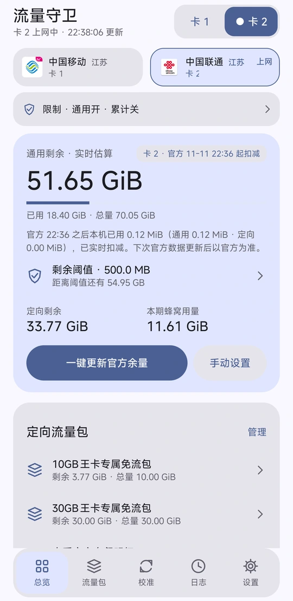
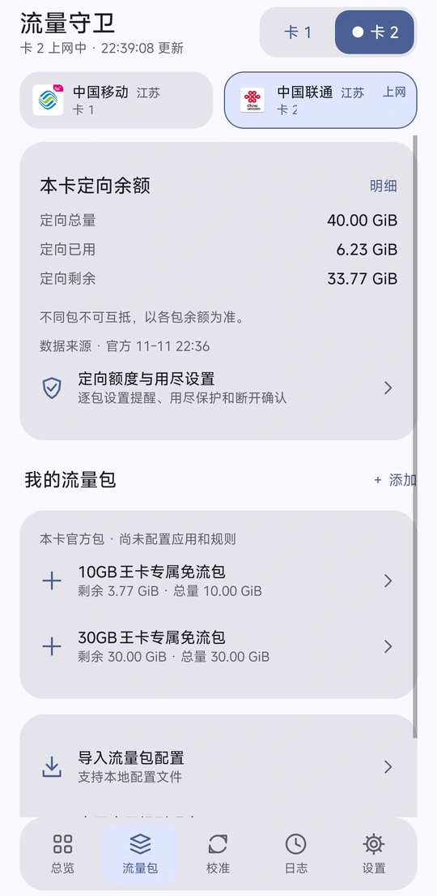
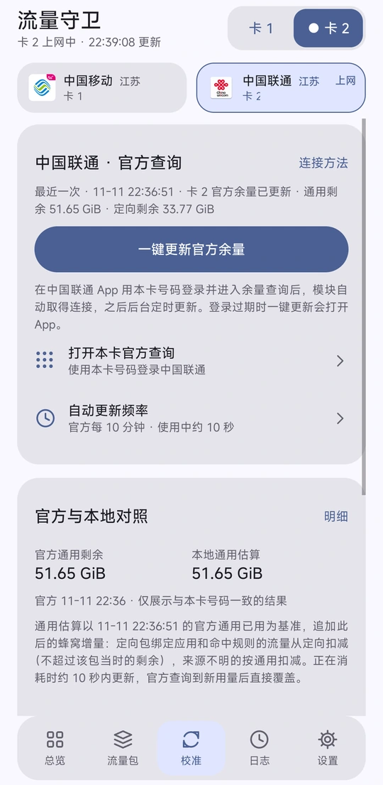
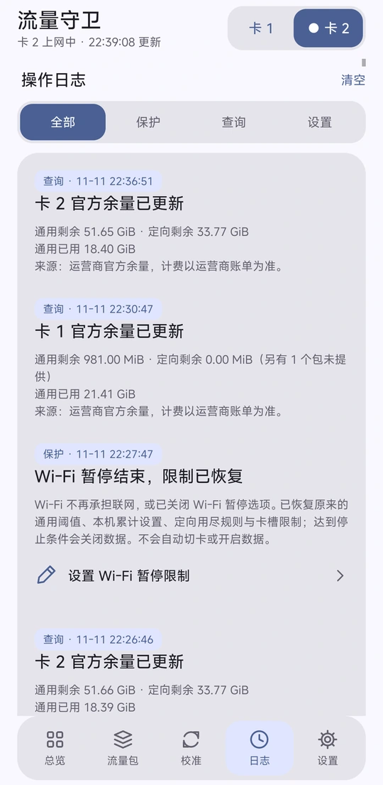
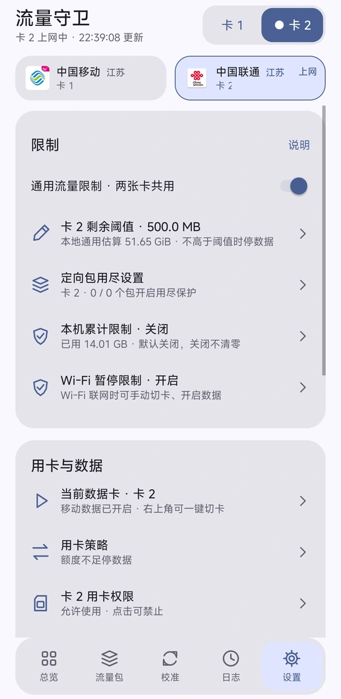

# 流量守卫

流量守卫是面向 Android 的双卡流量监控与额度保护模块。按 SIM 分别记录用量、读取官方余额并估算查询后的消耗。额度不足时可停止移动数据、自动切到符合条件的备用卡，或按指定卡使用。模块使用 Root 守护进程和 LSPosed（libxposed API 102），不占用 VPN 槽位。

**最低 Android 14，需要 Root 与支持 API 102 的 LSPosed。** 从 [GitHub Releases](https://github.com/Android-Modules/MobileDataMonitoring/releases/latest) 下载 `MobileDataGuard-版本号-release.apk`。每个版本附带 SHA-256 校验文件，同签名的生产包可覆盖升级。

## 页面截图

以下为 0.9.13 在 Redmi K90 上的原生页面，已遮盖 SIM 号码和系统状态栏。

| 总览 | 流量包 | 校准 |
| :---: | :---: | :---: |
|  |  |  |

| 日志 | 设置 |
| :---: | :---: |
|  |  |

## 安装与首次设置

1. 安装生产 APK。在 LSPosed 启用流量守卫和「电话服务」作用域。使用中国联通或中国移动江苏的官方 App 读取时，再启用对应 App 的作用域。全国版「中国移动」App 无需勾选。
2. 打开流量守卫并授权 Root。需要常驻通知和提醒时，允许通知权限。重启后在「设置 → 模块」查看 Root 监控、电话保护和 LSPosed 状态。
3. 在「总览」点顶部 SIM 卡片查看对应卡。右上角带圆点的是当前上网卡。双卡时，右上角是实际切卡入口，切换前会核验目标卡的额度和用卡权限。
4. 打开「校准」，按本卡运营商连接官方查询，再点「一键更新官方余量」。同步成功后，总览和日志会显示结果。若暂时无法同步，可用总览的「手动设置」填写本卡通用剩余。
5. 到「设置」检查通用流量限制、每卡剩余阈值及用卡策略，再按需要开启本机累计限制、定向包用尽保护或断开确认。

主用户安装流量守卫即可。运营商 App 使用哪个账号，取决于所选 SIM 对应的号码。换卡后先核对顶部的运营商和卡槽，再操作校准或用卡权限。

## 官方余量和自动更新

| 运营商 | 连接方式 |
| --- | --- |
| 中国移动 | 在「校准 → 网上营业厅」用本卡号码和短信验证码登录。支持手动与后台定时查询。「清空网页数据」可清除模块内网上营业厅的登录状态和缓存，登录后可再次使用。 |
| 江苏移动 | 也可使用「中国移动江苏」App。启用其 LSPosed 作用域，用本卡号码登录，在 App 内进入完整「余量查询」一次。模块可在后台读取该页面。移动卡也可手动发短信查余量，或逐卡启用短信备用。 |
| 中国联通 | 启用「中国联通」App 的 LSPosed 作用域，用本卡号码登录并进入余量查询。连接匹配本机 SIM 后自动保存，可定时更新。登录失效时一键更新会引导回官方 App。两张联通卡分别关联自己的账号。 |
| 中国电信及其他 | 支持本地统计和手动校准。电信卡可从校准页打开官方 App 查询。 |

「校准 → 自动更新频率」可设置官方查询间隔（默认 10 分钟，范围 1–10080 分钟）及本机统计同步间隔（默认 1 分钟，范围 1–60 分钟）。移动卡自动短信默认关闭，开启后每卡最多每小时一次。网页仍处于登录状态但暂时读不到时，定时查询会重试网页。查看「日志 → 查询」可确认结果与失败原因。

总览的**通用剩余 · 实时估算**从最新的官方通用余额中扣除其后的本机通用流量。正在使用蜂窝数据时，通用和定向的归类通常约 10 秒更新一次。无法归类的流量先计入通用，官方查询到新的余额后用官方结果重新校准。手动设置的通用剩余同样会随本机用量递减。账期按北京时间计算，费用以运营商账单为准。

## 用卡与流量保护

- **通用阈值**：默认剩余阈值为 500 MB，每张卡可单独修改。通用限制开启时，本卡可用估算达到或低于阈值会触发保护。余量未知、统计暂不可用等模块异常在日常模式下保持当前联网状态。
- **本机累计限制**：默认关闭。按本机蜂窝收发用量累计，包含通用、定向和后台流量。关闭开关保留计数，计数独立于运营商月账期。
- **用卡策略与权限**：可选额度不足停数据、自动切卡或固定用卡。「用卡与数据」可逐卡设置权限，权限跟随 SIM；被禁止的卡不会作为自动切换目标。保存设置后如需恢复移动数据，可在设置页点「核验后恢复」。
- **Wi-Fi 暂停限制**：默认开启。当系统默认网络是已验证联网的 Wi-Fi 时，暂缓额度与用卡策略，允许手动切卡。Wi-Fi 断开后重新核验原规则，计数连续记录。
- **关闭模块**：「设置 → 关闭模块并恢复系统」会停止监控及开机启动，把移动数据交回系统管理。原设置、流量包和记录可在重新启用后继续使用。

## 定向流量包

更新官方余量后，在「流量包」点击待配置的套餐，或用「添加」手动创建。一个包可以配置多个应用和多条规则。应用列表显示图标，支持按名称或包名搜索，也可以填写未安装应用的包名。规则每行一条，可粘贴网址，支持任一／同时命中、优先级和共享池。

用尽提醒、用尽保护和「使用通用流量前先断开并确认」按包配置。只有使用对应应用或命中规则时才判断该包。规则命中用于本机估算，是否免流由运营商计费决定。需要补录用量时，在本包「已用量与用尽设置」中填本期已用量，后续追加本机识别增量，也可恢复自动估算。

套餐额度及手动用量使用 GiB／MiB（1 GiB = 1024 MiB），通用阈值和本机累计上限使用十进制 GB／MB。各定向包的额度分别管理。套外用量和费用单独展示，费用未提供时会标明。

## 后台运行、日志和备份

- **需要把 App 留在最近任务吗？** 可以从最近任务划走。Root 守护进程和电话进程 Hook 负责监控、用卡保护和定时查询。常驻通知、Toast 和用量提醒由应用前台服务提供。依赖这些提醒时，可在 HyperOS 为流量守卫开启自启动并将电池策略设为「无限制」。
- **怎么查断网原因？** 「日志」可按保护、查询、设置分类查看最近 500 条记录。保护日志会列出原因并提供对应设置入口。「清空」只清除日志。
- **怎么换机？** 「设置 → 备份与导入设置」将流量包、规则、阈值和用卡策略导出为 JSON，导入前可预览。设置按 SIM 身份恢复。登录信息、官方余额和用量记录保留在原设备，换机后重新连接官方查询。

官方结果按运营商和号码匹配本机 SIM 后才应用。账户信息和用量账本仅保存在设备上。审查和设备验证记录见 [CODE_REVIEW.md](CODE_REVIEW.md) 与 [TEST_REPORT.md](TEST_REPORT.md)，页面设计见 [原生界面说明](design/NATIVE_UX.md)。

## 构建

使用 JDK 21、Android SDK Platform 37.0 和项目 Gradle Wrapper。代码编译目标为 Java 17。

```sh
sh ./gradlew :core:test :app:lintDebug :app:assembleDebug
sh ./gradlew :core:test :app:lintRelease :app:assembleRelease
```

生产包输出至 `app/build/outputs/apk/release/app-release.apk`，使用 `.private/release-signing.properties` 配置的生产密钥。已有生产安装应始终沿用同一签名。调试包与生产包的签名不同，无法互相覆盖。

## 发布流程

1. 确认版本名与版本号后，在主分支提交上推送对应的 `v<版本名>` 标签。「Android release」工作流运行 core 测试、Release Lint 并上传 `unsigned-release` 构建产物。也可在主分支手动运行工作流，只填写标签，重新构建该标签。
2. 下载该构建产物，在本机用生产密钥及 `apksigner sign --v1-signing-enabled false` 签名，生成 `MobileDataGuard-<版本名>-release.apk`，并在同目录生成包含 APK 文件名的 SHA-256 校验文件。将两个文件上传到该标签的 GitHub Release 草稿。生产密钥只保存在本机。
3. 从主分支手动运行「Android release」，填写标签及构建 run ID。工作流核对标签对应的成功构建、APK 内容、生产证书和 SHA-256 后发布草稿。

如需从终端触发最后一步，可在上传草稿附件后运行：

```sh
gh workflow run release.yml --ref main -f tag="$tag" -f build_run="$build_run"
```
